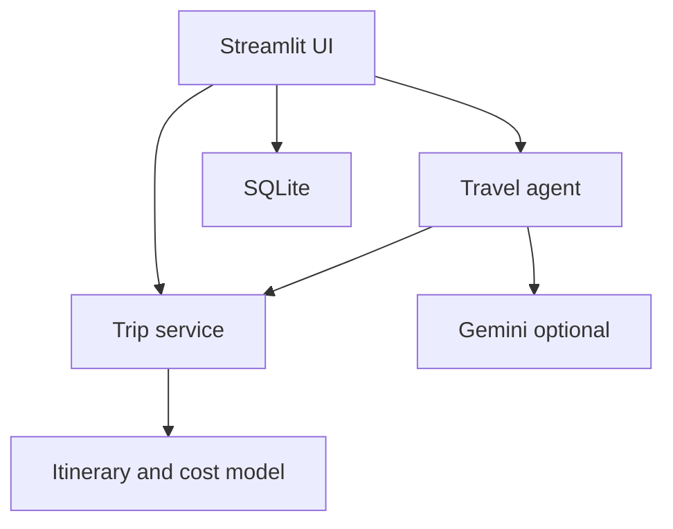

# TripWise – AI Smart Travel Planning Agent

**AIAD mini-project:** A Streamlit travel planner with optional Gemini integration, SQLite persistence, trip itineraries, cost estimates, packing checklist and an intent-based assistant.

## Problem statement and objective
Travelers need a quick way to compare destinations, plan activities and estimate costs. TripWise provides a single dashboard for a personalized illustrative itinerary and cost breakdown.

## Features
Trip form; destination exploration; day-wise itinerary; estimated budget and chart; budget optimization; illustrative accommodations; transport comparison; general weather advice; attractions; local food; interactive packing checklist; destination map; context-aware fallback chat.

## Architecture


## Install and run
```bash
python3 -m venv .venv
source .venv/bin/activate
pip install -r requirements.txt
cp .env.example .env
streamlit run app.py --server.address 0.0.0.0 --server.port 8501
```
Open `http://localhost:8501` locally. On a VPS use SSH port forwarding `ssh -L 8501:localhost:8501 user@your-vps-ip` and run Streamlit bound to `127.0.0.1` for private access.

## Test
```bash
python -m compileall .
python -m pytest -q
```

## API configuration
Set `GEMINI_API_KEY` in `.env` to enable Gemini for questions outside the fallback intent registry. Do not commit `.env`.

## Demo mode
Without keys, itinerary, estimated budgets, accommodation types, transport options, destination map and chatbot intents still work. All prices are illustrative, not verified live prices. No hotel availability, restaurant listing, weather forecast, attraction routing or distance is verified.

## Limitations and future scope
Fallback chat supports a limited set of intents; it does not reliably modify dates, replace hotels or add attractions. Route map is a destination pin, not optimized turn-by-turn navigation. Real hotel, weather, restaurant and routing APIs plus structured Gemini editing are future improvements.

## VPS deployment
Run privately via SSH forwarding first. `deployment/tripwise.service` provides a sample systemd unit; change the user and directory to match your environment. Avoid exposing port 8501 publicly. Configure Nginx/TLS only after validating domain, DNS and current server configuration.

## Feature coverage and verification (updated)
The app includes all 13 feature areas: personalized planning, destination recommendations, day-wise itinerary, budget estimates, budget optimization, illustrative accommodations, illustrative transportation, offline weather guidance, attraction suggestions and itinerary insertion, regional food ideas, packing checkboxes, attraction-marker route ordering, and a context-aware chat assistant. It also supports SQLite save/load/delete. **These are offline-first demonstrations, not verified bookings or live routing/weather services.**

The route tool uses a nearest-neighbor heuristic on a small curated set of approximate attraction coordinates. Its displayed distance is straight-line, **not driving/walking distance**. For destinations outside the sample database, generic suggestions are shown.

Run `python -m pytest -q` and `python -m compileall -q .` to verify core logic. The package was tested with 12 passing unit tests, but a live Streamlit browser test was **not performed** in the authoring environment because Streamlit was not installed there. Test the web UI after installing requirements on the target machine.

## VPS install
Copy this directory to `/opt/tripwise` and run:

```bash
cd /opt/tripwise
python3 -m venv .venv
. .venv/bin/activate
pip install -r requirements.txt
cp .env.example .env
python -m pytest -q
streamlit run app.py --server.address 127.0.0.1 --server.port 8501
```

For persistent deployment, inspect the VPS first; adjust the service `User=` to a dedicated account with write access to the project database, then install `deployment/tripwise.service` under `/etc/systemd/system/`, run `sudo systemctl daemon-reload`, `sudo systemctl enable --now tripwise`, and inspect `sudo journalctl -u tripwise -f`. Configure `deployment/nginx.conf` to match an actual DNS name and verify existing Nginx sites before enabling it. Only enable HTTPS after DNS resolves correctly.

## Updated dynamic budget and AI assistant

Trip estimates now recalculate from destination, travel dates, traveler count, travel style, transport mode, and accommodation type. Budget is treated as a spending cap, not an expense multiplier. All rates are illustrative offline planning assumptions, not live quotations. The chatbot can create a new trip from a natural-language request without requiring Gemini. Common trip edits are handled with deterministic tools. Gemini is optional for open-ended questions.

Run all tests: `python -m pytest -q`.

## October 2026 enhanced validation

This release includes input-sensitive cost estimates, chat trip creation, transport switching, preservation of edited activities when extending a trip or changing accommodation, export to JSON, and 38 automated tests.

Run `python -m pytest -q` and `python -m compileall -q .` before starting. Run the Streamlit app using `python -m streamlit run app.py`. Set `.env` using `.env.example`. Gemini is optional. A configured key does **not** guarantee the external API is reachable; local trip tools work independently. Hotel and restaurant names are illustrative categories and food ideas, not verified live properties or listings. Route markers and straight-line distances are not road navigation. Weather suggestions are offline, not live forecasts. This project is intended for an educational demonstration, not live booking.
